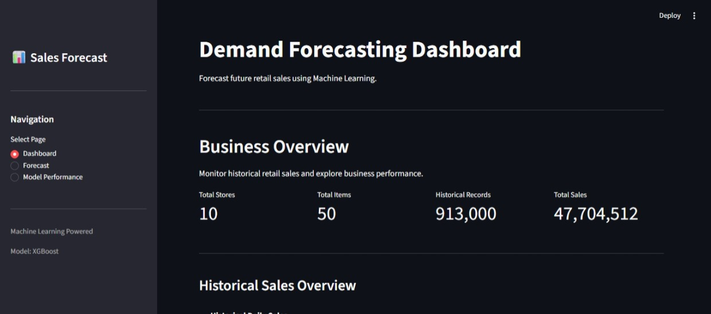
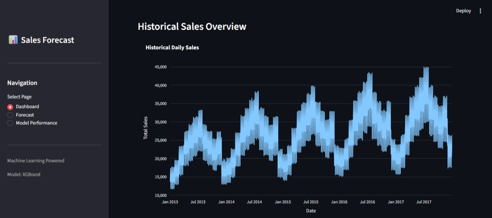
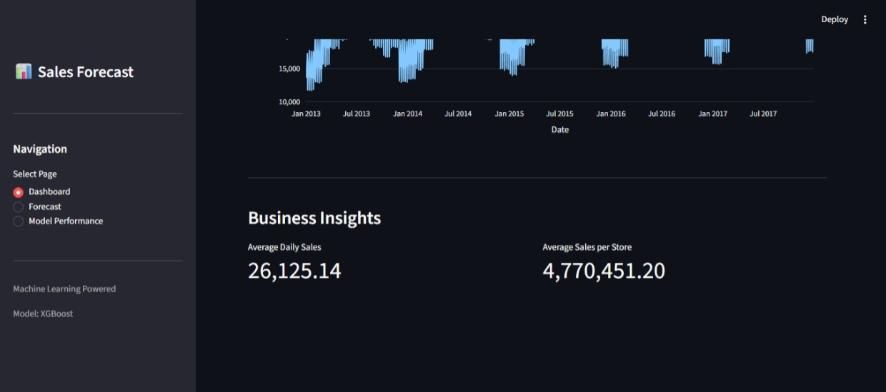
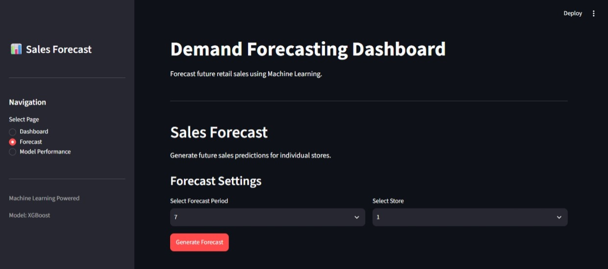
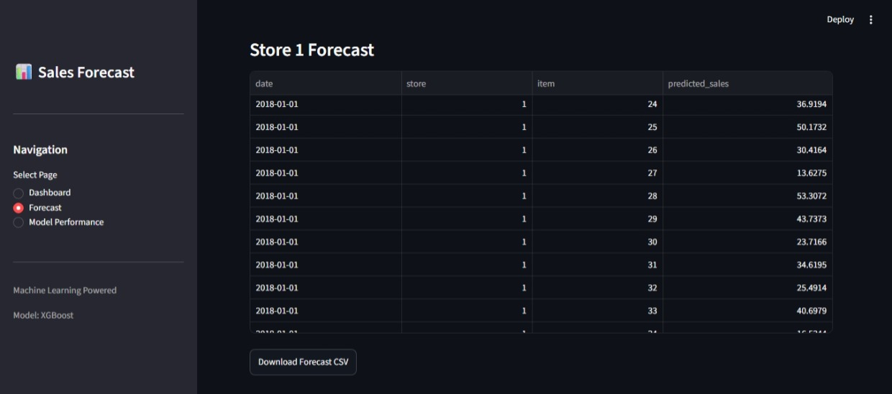
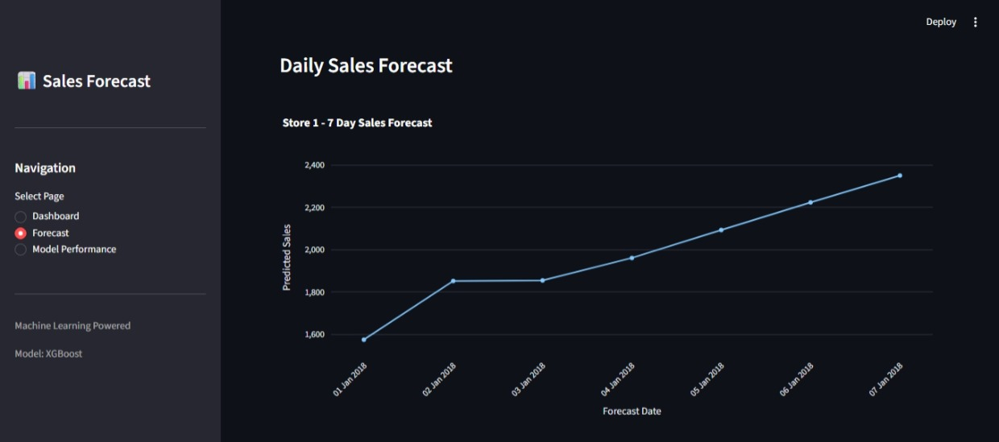
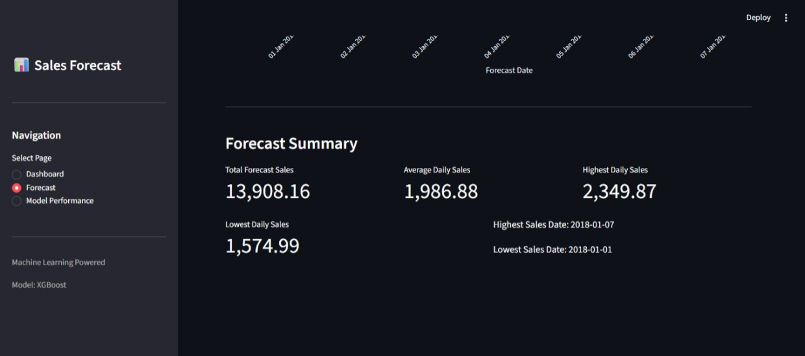
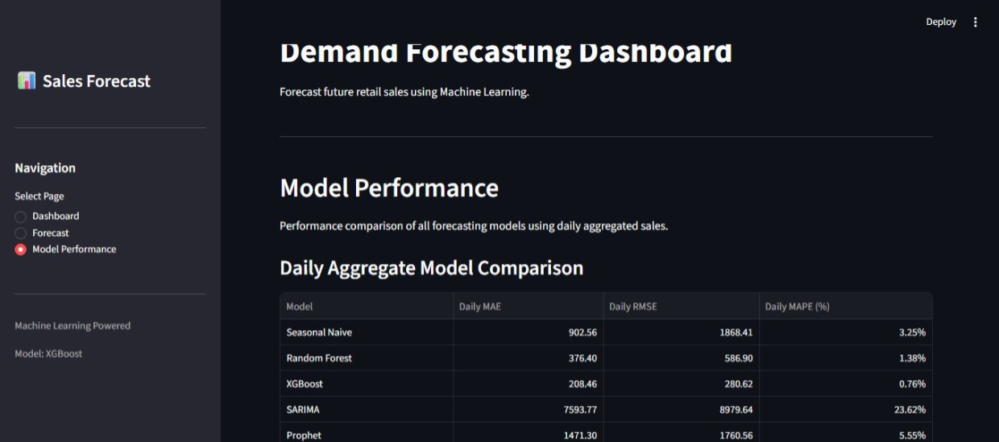
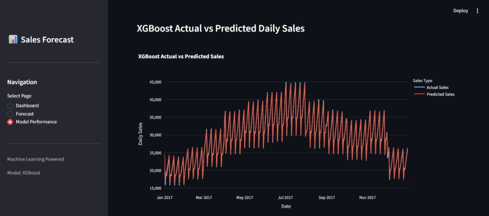
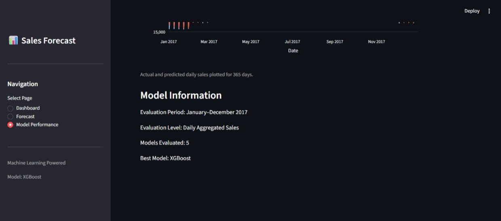

# Demand Forecasting and Sales Prediction

## Project Overview

Demand Forecasting and Sales Prediction is a machine learning project designed to forecast retail sales using historical sales data. The project analyzes sales patterns, compares multiple forecasting algorithms, and identifies the best-performing model for predicting future sales.

The project uses the Store Item Demand Forecasting dataset and implements Seasonal Naive, Random Forest, XGBoost, SARIMA, and Prophet forecasting approaches.

An interactive Streamlit dashboard is developed to visualize historical sales, generate future sales forecasts, and display model performance comparisons.

## Dataset

| Attribute        | Description              |
| ---------------- | ------------------------ |
| Total Records    | 913,000                  |
| Number of Stores | 10                       |
| Number of Items  | 50                       |
| Data Period      | 2013–2017                |
| Features         | date, store, item, sales |
| Target Variable  | sales                    |

Download the dataset from the following link:

- [Download store_sales.csv](https://raw.githubusercontent.com/skforecast/skforecast-datasets/main/data/store_sales.csv)


## Technologies Used

- Python
- Pandas
- NumPy
- Matplotlib
- Seaborn
- Scikit-learn
- XGBoost
- Statsmodels
- Prophet
- Plotly
- Streamlit
- Joblib
- Jupyter Notebook

## Machine Learning Models

- Seasonal Naive Forecasting
- Random Forest Regressor
- XGBoost Regressor
- SARIMA
- Prophet

## Model Evaluation

Models were evaluated using daily aggregated sales for January–December 2017.

| Model          |     MAE |    RMSE | MAPE (%) |
| -------------- | ------: | ------: | -------: |
| Seasonal Naive |  902.56 | 1868.41 |   3.2459 |
| Random Forest  |  376.40 |  586.90 |   1.3832 |
| XGBoost        |  208.46 |  280.62 |   0.7583 |
| SARIMA         | 7593.77 | 8979.64 |  23.6154 |
| Prophet        | 1471.30 | 1760.56 |   5.5549 |

### Best Model: XGBoost

- MAE: 208.46
- RMSE: 280.62
- MAPE: 0.7583%

XGBoost achieved the best performance among the evaluated forecasting models and was selected for future sales predictions.

## Project Structure


Demand-Forecasting-Sales-Prediction/
│
├── .venv/
│
├── data/
│   ├── raw/
│   │   └── store_sales.csv
│   └── processed/
│       └── xgboost_daily_comparison.csv
│
├── models/
│   └── xgboost_sales_model.pkl
│
├── notebooks/
│   └── demand_forecasting.ipynb
│
├── reports/
│   ├── daily_model_comparison.csv
│   ├── recursive_sales_forecast.csv
│   └── store_7_day_forecast.csv
│
├── src/
│   ├── __pycache__/
│   └── forecasting.py
│
├── visualizations/
│   ├── EDA graphs
│   ├── Model evaluation graphs
│   └── Dashboard screenshots
│
├── app.py
├── requirements.txt
├── .gitignore
└── README.md


## Streamlit Dashboard

The dashboard contains three main sections.

### Dashboard

- Displays total stores, items, historical records, and total sales.
- Visualizes historical daily sales.
- Provides business overview metrics.

### Forecast

- Select a store and forecast period.
- Generate future sales predictions.
- Visualize daily forecasted sales.
- Display forecast summary metrics.
- Download forecast results as CSV.

### Model Performance

- Displays model evaluation metrics.
- Compares five forecasting models.
- Visualizes actual versus predicted daily sales.
- Identifies the best-performing model.

## Dashboard Screenshots

### Dashboard






### Sales Forecast









### Model Performance








## Installation and Setup

### 1. Clone the Repository

```bash
git clone https://github.com/Anil-Vana/Demand-Forecasting-Sales-Prediction.git
cd Demand-Forecasting-Sales-Prediction
```

```

### 2. Create a Virtual Environment

```bash
python -m venv .venv
```

### 3. Activate the Virtual Environment

Windows:

```bash
.venv\Scripts\activate
```

### 4. Install Dependencies

```bash
pip install -r requirements.txt
```

### 5. Run the Application

```bash
streamlit run app.py
```

## Project Workflow

1. Data loading
2. Data cleaning and preprocessing
3. Exploratory data analysis
4. Feature engineering
5. Model training
6. Model evaluation
7. Model comparison
8. Best model selection
9. Sales forecasting
10. Streamlit dashboard development

## Key Results

- Analyzed 913,000 historical sales records.
- Evaluated five forecasting models.
- Compared models using MAE, RMSE, and MAPE.
- Achieved the best forecasting performance using XGBoost.
- Developed an interactive Streamlit forecasting dashboard.
- Implemented store-specific sales forecasting.
- Enabled CSV download of forecast results.

## Future Scope

- Item-level sales forecasting.
- Hyperparameter optimization.
- Cloud deployment.
- Inventory and demand planning integration.
